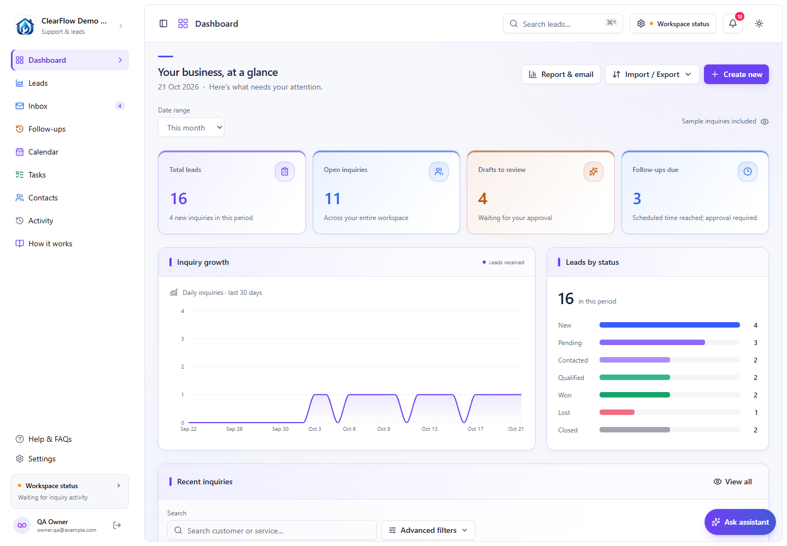

# CustomerLead CRM

An AI customer support and lead inquiry application for ClearFlow Plumbing.
The active Next.js application is **`templates/leads`**.

Customers submit an inquiry by form or email. n8n and Gemini classify the inquiry
and prepare a suggested reply. The owner manages leads, reviews replies, approves
consented follow-ups and monitors confirmed delivery from the dashboard.
Approving a draft does not send it; delivery requires the separate sending action
and a confirmed Gmail result.

## Start here

Returning to the project? Read [Welcome back](docs/start-here.md) for the current
checkpoint and what remains. The website and Supabase are set up; hosting the
local n8n automation is still pending.

The [illustrated setup guide](docs/setup-combined-workflow.md) follows the selected
**128-node combined Gemini workflow**, with fictional customers, seven dashboard
pictures, Sheet headers and an inactive workflow example with account bindings
removed. Use it for a fresh practice setup; keep the existing live workspace.



## Project layout

| Path | Purpose |
| --- | --- |
| `templates/leads` | Next.js application, API routes and automated tests |
| `supabase` | Workspace access and private CRM storage migrations |
| `scripts` | Local development, migration, backup and isolated verification tools |
| `docs` | Setup, deployment and feature guides |
| `deploy/customerlead` | Alternative Docker deployment configuration |

This repository contains the CRM application. The original template catalog,
other template applications, local runtime tools, customer records, credentials,
private workflow exports and backups are excluded.

## Run locally

Use Node.js 22 (at least 22.17) and pnpm 10.34.7.

```sh
cd templates/leads
pnpm install --frozen-lockfile
```

Copy `.env.example` to `.env.local` and configure the values privately. Existing
installations must retain their current environment and cloud workspace.
See the [step-by-step setup](docs/setup-combined-workflow.md) and
[authentication reference](docs/login-and-assistant.md).

```sh
pnpm dev --hostname 127.0.0.1 --port 3001
```

Open `http://localhost:3001`. Never commit `.env.local`, `.data`, exported customer
records or decrypted n8n credentials. CRM storage supports a local development
backend and a private Supabase backend; Vercel requires the Supabase backend.

## Deployment

For Vercel, import this repository and set **Root Directory** to
**`templates/leads`**. Configure environment variables in Vercel separately.
Supabase hosts authentication, CRM storage and private files. Host the existing
n8n automation separately; Vercel does not run its background schedules.

Follow the [setup and hosting guide](docs/setup-combined-workflow.md).
Publishing source code does not deploy the application or activate workflows.

## Verification

From `templates/leads`:

```sh
pnpm test
pnpm exec tsc --noEmit
pnpm build
```

The workflow wiring and unified workflow tests require the privately retained,
reviewed n8n exports described in `scripts/n8n/source-reference.json` and
`scripts/n8n/unified-sources.json`. Those exports are intentionally absent from
the repository. Cloud storage tests (`pnpm test:cloud`) require Docker and use
isolated PostgreSQL. Browser checks in `scripts/check-*.mjs` use isolated data;
they must never send real customer email.

## License

The application incorporates Square UI / ln-dev UI components. Their original
terms are preserved in [LICENSE.md](LICENSE.md); this repository does not grant
permission to redistribute those components as a template or UI library.
