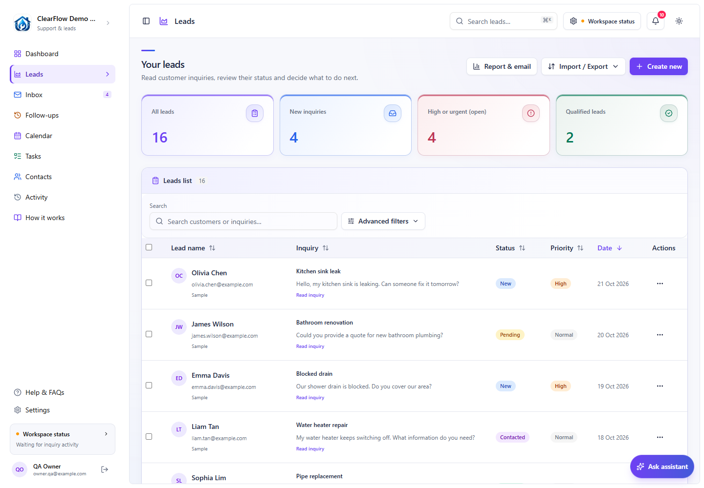
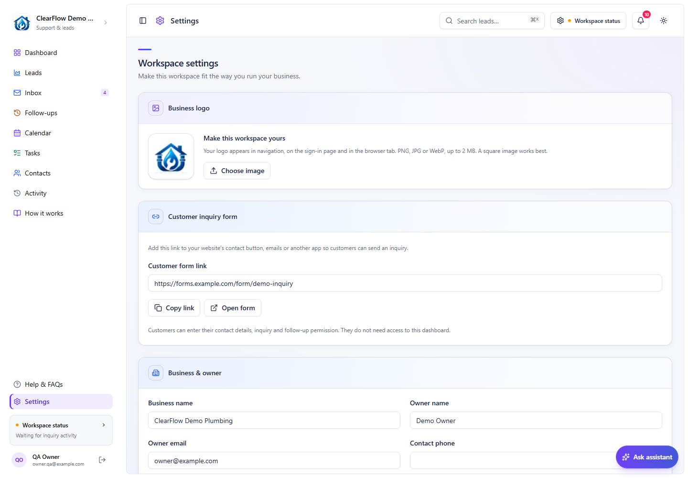
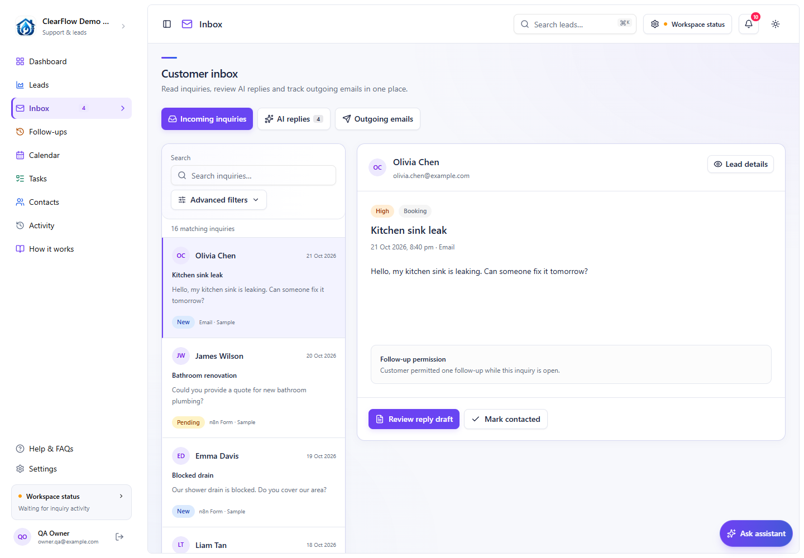
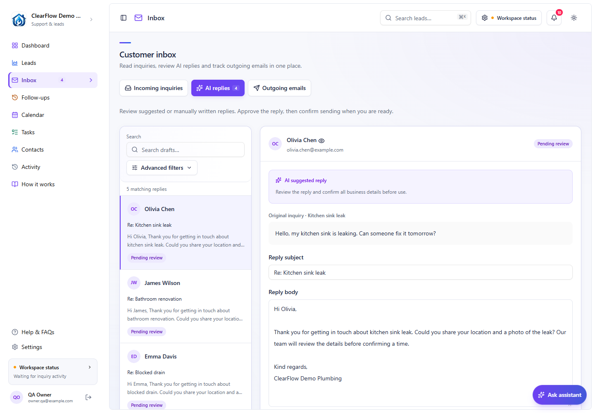
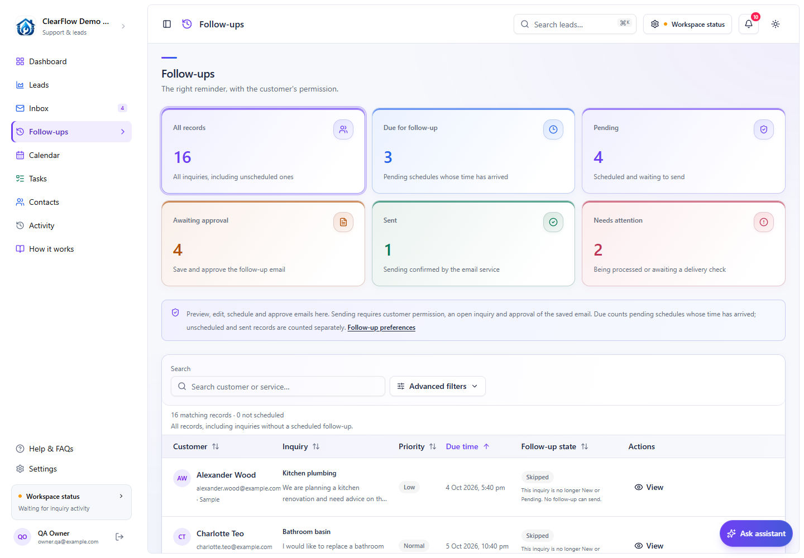
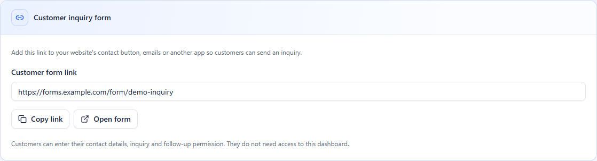

# Set up CustomerLead with the combined workflow

This guide follows one inquiry from the form or inbox to a reviewed reply. Work through one section at a time; the **Check** at the end tells you what should be working before you continue.

Already using this project? Read [Welcome back](start-here.md) first. The existing Vercel website and Supabase storage are set up. The fresh-install instructions below are for a **separate practice copy**; your current records and credentials should stay as they are.

All screenshots use fictional customers in **ClearFlow Demo Plumbing**. Addresses ending in `example.com` are illustration addresses, not inboxes for delivery tests.

## 1. Know what you are connecting

| Name | What it does |
| --- | --- |
| CustomerLead / Vercel | The dashboard and its application API. This app lives in `templates/leads`. |
| Supabase | Team login, the saved CRM workspace, and private reports/configuration. |
| n8n | Runs the combined workflow: capture, AI processing, sync, replies and follow-ups. |
| Gmail | Receives inquiries, holds drafts, and sends the emails you permit. |
| Google Sheets | Keeps the shared `Leads` and `ReplyReviews` records used by the workflow. |
| Gemini | Classifies inquiries and prepares suggestions. It does not confirm delivery. |

There are two different databases: Supabase stores the **CRM**, while n8n's own database stores its **workflows, credentials and executions**. Moving CRM records to Supabase does not move n8n.

### Files to keep handy

- [Combined workflow example](workflows/customerlead-combined.example.json) — 128 nodes; inactive and unconfigured.
- [Leads headers](examples/Leads.headers.csv) and [ReplyReviews headers](examples/ReplyReviews.headers.csv) — headers only, no customers.
- [Fictional inquiry](examples/practice-inquiry.json) — copy these details into a practice form.
- [Source review](workflows/source-review.json) — identifies the exact export this guide follows.

For the existing system, retain the original private export and its existing accounts. For a new demo, download the example JSON with GitHub's **Raw / Download raw file** control. Save the JSON itself, not the GitHub HTML page.

## 2. Open the dashboard

### Existing installation

Open the current Vercel project → **Visit** → sign in with your existing application account. A Vercel/GitHub account is different from the application's Supabase login.

If the login page says **“Sign-in is being set up”**, check the two `NEXT_PUBLIC_SUPABASE_…` variables in Vercel, then redeploy. Do not create another project to repair missing settings.

### Fresh practice installation

Use Node.js **22** (at least 22.17) and pnpm **10.34.7**. In a fresh clone:

```powershell
cd templates/leads
pnpm install --frozen-lockfile
Copy-Item .env.example .env.local
```

Only copy that file when `.env.local` does not already exist. Fill it privately; never commit its values.

1. In a **separate Supabase practice project**, open **SQL Editor → New query**. Run [the workspace access migration](../supabase/migrations/202610200001_crm_workspace_access.sql), then [the private CRM storage migration](../supabase/migrations/202610210001_crm_cloud_storage.sql).
2. Open **Authentication → Users → Add user**. Create your own application login with an email you control. Keep public sign-ups disabled for this invitation-only workspace.
3. Run this owner-membership SQL after replacing the fictional email with that login's real email. Expect one returned row:

   ```sql
   insert into public.crm_workspace_members (user_id, workspace_id, role, display_name)
   select id, 'clearflow', 'owner', 'Demo Owner'
   from auth.users where lower(email) = 'owner@example.com'
   on conflict (user_id) do update set role = excluded.role, display_name = excluded.display_name
   returning user_id, workspace_id, role;
   ```

4. In the new copy's `.env.local`, add the Supabase project URL, publishable key, server secret key and a newly generated private `N8N_WEBHOOK_SECRET`. Keep `CRM_STORAGE_BACKEND=local` for this first local practice run. Use a separate `CRM_DATA_DIR`, such as `C:/private/customerlead-demo`. Do not point this at your existing records.
5. Start the local practice app:

   ```powershell
   pnpm dev --hostname 127.0.0.1 --port 3001
   ```

6. Open `http://localhost:3001`, sign in, and check the fictional sample leads. A new local directory starts with sample data; sample records cannot send email. In **Settings**, leave **Automatic emails** off and save.

**Check:** you can sign in and open **Leads**, **Inbox**, **Follow-ups** and **Settings**. The demo contains only fictional customers. Do not run the fresh setup against the existing cloud workspace.



### If you also want the practice website on Vercel

First initialize the **separate practice Supabase workspace**. Stop the practice app and any workflows writing to it. From the repository root, review this import plan, using the same private demo directory from above:

```powershell
node --env-file=templates/leads/.env.local --experimental-strip-types scripts/migrate-crm-to-supabase.mjs --data-dir C:/private/customerlead-demo
```

For a confirmed fresh practice project, run the same command with `--apply --source-stopped`. The tool backs up the source, imports once and compares the full state. It refuses to overwrite different cloud records. After successful verification, set `CRM_STORAGE_BACKEND=supabase` and restart. **Skip this entire import for the existing installation: it is already migrated.**

In Vercel, import the repository using **Next.js**, **Root Directory `templates/leads`**, **Node 22.x**, install `pnpm install --frozen-lockfile`, and build `pnpm build`. Keep the default Next.js output setting.

Add these variables to **Production**, copying values privately from the matching Supabase project/environment:

| Key | Value | Vercel type |
| --- | --- | --- |
| `NEXT_PUBLIC_SUPABASE_URL` | Supabase project URL | Config |
| `NEXT_PUBLIC_SUPABASE_PUBLISHABLE_KEY` | Supabase public publishable key | Config |
| `CRM_STORAGE_BACKEND` | `supabase` | Config |
| `SUPABASE_SECRET_KEY` | Same project's server-only secret | Secret |
| `N8N_WEBHOOK_SECRET` | Same token used by the CRM credential in n8n | Secret |

Deploy/redeploy after saving. In Supabase **Authentication → URL Configuration**, set the production Site URL and allow the actual site's `/auth/callback` and `/auth/callback?next=/update-password` URLs. Keep needed local redirects too. The `/auth/confirm` reset/invite templates are explained in the [authentication guide](login-and-assistant.md). See [Supabase redirect configuration](https://supabase.com/docs/guides/auth/redirect-urls).

Environment changes apply to a new deployment. Keep preview environments on separate practice storage. See [Vercel environment variables](https://vercel.com/docs/environment-variables).

## 3. Prepare Google Sheets and the four connections

### Make two Sheet tabs

For a new demo, create a spreadsheet called **CustomerLead Demo**. Add two tabs with these exact names:

| Tab | First row | Match column |
| --- | --- | --- |
| `Leads` | Import/copy [Leads.headers.csv](examples/Leads.headers.csv) into row 1 | `Lead_ID` |
| `ReplyReviews` | Import/copy [ReplyReviews.headers.csv](examples/ReplyReviews.headers.csv) into row 1 | `Draft_ID` |

Use **File → Import → Upload**, select the CSV and import into the matching empty tab. Check that each header is in its own column. Extra spaces matter: `Draft_ID` and `Draft_ID ` are different headers. Importing headers into a populated tab can overwrite data, so retain the existing tabs for your current system.

Copy the spreadsheet ID: it is the part between `/d/` and `/edit` in its browser address. Keep that ID privately for the next section.

### Connect the accounts in n8n

Open the existing n8n editor at `http://localhost:5678`. A new local installation should follow [n8n's Docker Compose instructions](https://docs.n8n.io/deploy/host-n8n/install-options/install-using-docker-compose); this project was reviewed against **n8n 2.43.8**. Retain its persistent data volume. Reuse the current installation and credentials when returning to this project.

| Connection | Credential in n8n | What to enter |
| --- | --- | --- |
| Business Gmail | Gmail OAuth2 | Connect the business inbox you intend to use. |
| Google Sheets | Google Sheets OAuth2 | Connect an account with access to the spreadsheet. |
| CRM API | HTTP Header Auth | Name: `Authorization`. Value: `Bearer ` followed by the app's `N8N_WEBHOOK_SECRET`. |
| Gemini | HTTP Header Auth | Name: `x-goog-api-key`. Value: your Gemini API key. |

The last two are different credentials even though n8n gives them the same type. Call them **CRM API** and **Gemini API** so they are easy to choose. Existing credential names can stay as they are.

For new Google OAuth credentials: enable Gmail and Google Sheets APIs in your Google Cloud project, configure the consent screen, and create a **Web application** OAuth client. Add the exact callback URL shown inside n8n's credential editor. Copy the full matching Client ID and Client Secret, then connect the Google account. An app in external testing also needs your account listed as a test user. Follow [n8n's Google OAuth setup](https://docs.n8n.io/integrations/builtin/credentials/google/oauth-generic/) for the current screens.

**Check:** Gmail **List Labels** succeeds and the Sheets credential can see the demo spreadsheet. “Client authentication failed” usually needs the saved Client ID/Secret pairing repaired and the account reconnected; creating a secret in Google Cloud does not update n8n automatically.

## 4. Connect the combined workflow

### Keep the existing workflow, or import the demo once

The existing system already has the combined workflow. Do not import another active copy. For a fresh practice installation, choose **Import from file**, select `customerlead-combined.example.json`, and keep it **unpublished** while you configure it.

The example deliberately cannot connect immediately: its credential bindings are empty and its URLs/Sheet ID are placeholders. The four timer paths, form path and node connections match the reviewed export.

1. Select **Gmail OAuth2** on Gmail nodes and Gmail HTTP requests. Select **Google Sheets OAuth2** on Sheets nodes and **Check Sheets connection**.
2. Select **Gemini API** on **AI — Gemini Primary** and **LEADS — Gemini Classify (Optional)**. Select **CRM API** on the CRM health/config/events/sync/mail/follow-up HTTP requests. Never put the CRM Bearer credential on a Gemini request.
3. In the example JSON, replace **every** `https://crm.example.invalid` with your CRM origin, keeping each `/api/n8n/…` path. The sync path also reads this origin from **Bridge settings → crmBaseUrl**.
4. Replace **every** `REPLACE_WITH_SPREADSHEET_ID` with your demo spreadsheet ID. This includes **Bridge settings**, the form business-settings Code node, **Check Sheets connection**, and **SHEETS — Read for Duplicate Check**. Other Sheet nodes already read these settings through expressions.
5. Check **Save shared lead** uses **Append or Update Row**, tab `Leads`, auto-mapping and match column `Lead_ID`. Check **Save reply review** uses the same operation, tab `ReplyReviews`, and match column `Draft_ID`. **Read existing lead** must filter `Lead_ID` using `{{ $json.payload.Lead_ID }}`.

For a fresh demo, the easiest way to replace placeholders is in a **private local copy of the JSON before importing**. Use your editor's Find/Replace All, save, and import it once. Keep that configured copy out of GitHub. In the original private export, the local origin is `http://host.docker.internal:3001`, and the spreadsheet references already point to the existing Sheet.

Choose the CRM origin that n8n can actually reach:

| Where n8n runs | CRM origin |
| --- | --- |
| Docker on this Windows PC, using local CRM | `http://host.docker.internal:3001` |
| Local Docker or a future hosted n8n, using Vercel CRM | Your stable `https://…vercel.app` Production origin |

In **Settings**, enter verified business facts, signature, owner address, timezone and follow-up delay. Save them. The workflow reads shared settings; keep those config expressions intact. For practice, leave **Automatic emails** off. That pauses automatic acknowledgements, alerts and follow-ups, but does **not** disable an owner's separately confirmed manual send.



**Gemini detail:** in the selected export, **AI — Gemini Primary** has its model written directly in its request URL. A Settings change alone does not replace that URL. If the model is unavailable to your key, select an available Gemini model and update that node. The optional form classifier reads its model from shared configuration. Use the [Gemini model documentation](https://ai.google.dev/gemini-api/docs/models) for availability.

### Run the connection check

Start at **Manual system check** and click **Execute workflow**. It reads CRM health, the Gmail profile and Sheet metadata. **System check complete** should report a ready CRM and the intended Gmail account/Sheet tabs.

This check does not run an inbox scan, call Gemini or send an email. It proves the three connections, not the complete customer journey. Authentication must reach the application API; an interactive Vercel protection page is not a valid health response.

**Check:** the manual connection check succeeds. Stop here if a connection fails. Leave old helper workflows unpublished; the combined workflow already handles sync and sending.

## 5. Try an inquiry without emailing anyone

Use a **separate demo CRM, spreadsheet and workflow**. A form submitted to a connected real system creates a real saved record, even when its name is fictional. Keep automatic emails off before submitting it.

1. Open **FORM — Customer Inquiry** in the demo workflow.
2. Choose its **Test URL** and start listening for a test submission. Leave the workflow unpublished while testing this path.
3. Enter these fictional details:

   | Field | Practice value |
   | --- | --- |
   | Full Name | Maya Chen |
   | Email Address | `maya@example.com` |
   | Phone Number | Leave blank |
   | Service Needed | Kitchen sink leak |
   | Message | My kitchen sink drips after I turn the tap off. Could you tell me what details you need for a quote? |
   | Follow-up Permission | Yes — one follow-up if my inquiry is still open |

4. Submit once. Check the n8n execution, a new `Leads` Sheet row, then **Leads** and **Inbox → Incoming inquiries** in the demo dashboard. Refresh if needed.
5. Open the lead, check its inquiry, priority, permission and schedule. AI classification needs a working Gemini credential; a failure can leave the inquiry for manual review.
6. Change an internal note. For an end-to-end sync test, publish **only this demo combined workflow**, with automatic emails still off, and let its minute sync run. Check the note in Sheets and **How it works** for a saved result. Connect only a separate test inbox: publishing also enables the email scanner.

**Check:** the inquiry is saved, permission matches the choice, and an owner edit reaches Sheets. The form path does not automatically create a Gmail support-reply draft; that suggested reply path begins with an incoming Gmail inquiry. Form acknowledgements and owner alerts are separate automatic-email options.



### Test Gmail and an actual reply later

Use **two inboxes you control** instead of `example.com` addresses. Publish only the intended combined workflow and send a fresh, relevant test inquiry to the connected business inbox. Wait for the next five-minute scan plus AI processing; already processed messages are excluded.

Check the inquiry in **Leads / Inbox** and its suggested reply in **Inbox → AI replies**. An irrelevant or screened message may have no draft. You can write a reply yourself.



Read the recipient, subject and body. Save edits, approve, then choose **Send via Gmail** only when you want an actual email sent. Confirm the recipient and content. The progress display should move through queued/sync/sending to **Sent** after Gmail confirms delivery. Verify the receiving inbox too.

Never use a dummy address for that send test. A **Needs Review** result means delivery is uncertain: check Gmail before any recovery action, rather than replaying the send node.

## 6. Understand the follow-up screen



Suppose Maya permits one reminder and her saved due time is tomorrow at 10:00. She can be **Pending** today while **Due for follow-up** remains zero. At 10:00 tomorrow the pending schedule becomes due. It still needs the sending conditions below before an email can leave.

| Label | What it means |
| --- | --- |
| Due for follow-up | A pending schedule whose saved time has arrived. This is a time-based count, not a delivery count. |
| Pending | A follow-up has been scheduled and is waiting. It may still need email approval. |
| Awaiting approval | The saved follow-up email needs owner approval. It can overlap the due view. |
| Skipped | No follow-up is currently proceeding; open the row for the reason, such as no permission or no schedule. |
| Reserved | A workflow has claimed the follow-up for processing. |
| Needs Review | Delivery needs a human check; do not assume it failed or resend automatically. |
| Sent | The email service confirmed this follow-up was sent. |

Open **View** on a follow-up to record permission, choose/reschedule its time, edit the email and save/approve it. The form can record permission automatically; the dashboard checkbox also lets the owner record permission actually received elsewhere. It is not permission to invent customer consent.

Sending requires permission, a **New or Pending** inquiry, a due pending schedule, approval of the saved email for its current recipient/time, enabled automatic emails and consented follow-ups, completed sync, and no competing manual/uncertain reply. The sample inquiries pictured cannot send. The workflow checks hourly, so “due at 10:00” does not promise delivery exactly at 10:00.

The Follow-ups page's metric cards respect its customer/inquiry search. Clear the search when checking totals. Changing the default delay affects new inquiries; existing saved schedules keep their time.

## 7. When you are ready to host the automation

**You can leave this for later.** The current website and cloud records are already set up. Northflank requested a card for this account; it is not a completed no-card deployment. Do not keep following the old Northflank steps to get past that screen.

Choose a host that can run n8n continuously, provide HTTPS, and preserve its database/configuration and any binary files across restarts. Check actual account eligibility, memory, disk, monthly usage and inactivity rules at that time. A free static website or a sleeping web service cannot provide n8n's uninterrupted schedules. No particular free host is guaranteed by this guide.

Once a suitable host is chosen, use this handover order:

1. **Back up the current system privately.** Pause writers for a consistent CRM export with `scripts/backup-supabase-crm.mjs`. Back up n8n's full database, configuration, original encryption key and required binary files. A workflow JSON file is not a complete backup. Follow [n8n's backup instructions](https://docs.n8n.io/deploy/host-n8n/keep-n8n-running/backup-and-restore).
2. **Restore to an inactive hosted copy.** Retain the current n8n version during migration. Preserve accounts, credentials, workflow/form IDs and encryption key. For SQLite → PostgreSQL, use n8n's supported entity migration for that version; do not upload a SQLite file as a PostgreSQL database or replace the encryption key. Keep all restored schedules unpublished.
3. **Set the real public origins.** Replace every Docker/local CRM origin in the hosted workflow with the Vercel Production origin, including **Bridge settings**. Keep `/api/n8n/…` paths and the matching private Bearer credential.
4. **Configure n8n's HTTPS address.** For reviewed n8n 2.43.8, set `N8N_WEBHOOK_URL=https://your-n8n-host/`, `N8N_EDITOR_BASE_URL=https://your-n8n-host/`, `N8N_HOST`, `N8N_PROTOCOL=https`, and internal port `5678`. Set trusted proxy hops for the actual host; one proxy uses `N8N_PROXY_HOPS=1`. The newer variable replaces deprecated `WEBHOOK_URL`. See [n8n reverse-proxy configuration](https://docs.n8n.io/deploy/host-n8n/configure-n8n/basic-configuration/configuration-examples/configure-webhook-urls-with-reverse-proxy).
5. **Reconnect and check.** Add the hosted credential editor's exact OAuth callback to Google Cloud. Verify Gmail/Sheets reads and the manual system check before sending. Confirm machine requests reach the Vercel app with the expected app authentication.
6. **Switch once.** Let current executions/sends finish. Stop the equivalent local workflow before publishing the hosted combined copy. Keep replaced separate helpers inactive. Two active copies can compete for the same inbox, queues and form.
7. **Set the customer form link.** Copy the **Production URL** displayed by the hosted **FORM — Customer Inquiry** node. Add it to Vercel as `CRM_CUSTOMER_FORM_URL` in Production, then redeploy. In **Settings → Customer inquiry form**, check **Open form**, then **Copy link**. Test it from another device/network. Customers do not need a CRM account.
8. **Prove it works with the PC off.** Use your controlled test inboxes and one form inquiry. Verify capture, draft review, owner-edit sync and an explicitly confirmed send. Check records survive a host restart. Keep private backups off that host.



*The picture uses `forms.example.com` to show the controls. It is not a working form. Your current local form does not become public merely because its URL is shown in Settings.*

## 8. When something looks wrong

| What you see | First thing to check |
| --- | --- |
| Website opens, no new inquiries arrive | Is local n8n running, and is the intended combined workflow published? Website hosting does not start n8n. |
| Sign-in setup warning | Vercel public Supabase variables, matching project, and a new deployment after saving. |
| Signed in but access denied | The login needs a `crm_workspace_members` row in the same project. |
| CRM connection fails | Correct reachable CRM origin and the matching `Authorization: Bearer …` credential. |
| Google says “Client authentication failed” | Saved OAuth ID/secret pairing, callback URL, and reconnect. |
| Sheets will not update a row | Correct tab, Append or Update operation, exact headers and match column; then publish the saved changes. |
| Gemini cannot generate | Valid Gemini key, available model, quota and the primary node's actual model URL. |
| Permission is Yes, due count is zero | No pending due time yet, a future time, a different follow-up state, or an active search. |
| Reply stays Queued | The minute sender must be running; required sync may still be waiting or need attention. |
| Customer link starts with localhost | It only works on that computer. Finish hosting n8n and use its production form address. |

## Done for today?

Bookmark [Welcome back](start-here.md), keep the private backups, and note the next unchecked item. When hosting resumes, start at section 7 rather than rebuilding the CRM.

Pictures were captured from isolated local sample data and mock login. The example workflow was checked for graph integrity, placeholders and removed bindings. Documentation preparation did not test a hosted automation, actual customer delivery or an elapsed follow-up.
