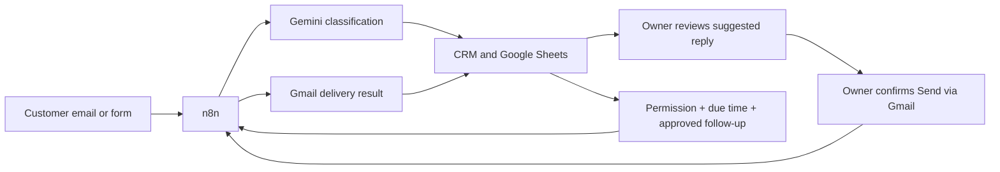

# Welcome back to CustomerLead

This is the place to start when you return. You do not need to set everything up again.

**Handover: 22 October 2026; last hosted-setup checkpoint: 21 October.** The website is on Vercel and the CRM records are in Supabase. The combined n8n automation remains installed in Docker on the Windows computer. It processes inquiries only while Docker/n8n is running. Automation hosting remains unfinished.

**24 October update:** the owner deferred hosting and chose the public CRM with
the existing Docker container. Follow [local Docker multi-user setup](local-docker-multi-user.md).
Private signup is deployed, Confirm Email is off, connection SQL is applied, and
the installed local worker's read-only API check passes. Google app/Production
configuration and real second-business verification remain pending. The original
workflow's local receiver address still needs alignment with the public CRM.

The new [private business accounts and hosting guide](business-accounts-and-hosting.md) describes immediate signup into a private workspace, without a confirmation email. Its Supabase migration, **Confirm Email off** policy and verified Production deployment are required; a code release does not change those platform settings. Signup needs no SMTP delivery; password recovery still uses email. Each new business starts with separate records and needs its own automation connection.


*Every picture in this guide comes from a separate demo workspace. Names, emails, messages and counts are fictional. They do not describe the live customer database.*

## What is ready?

| Part | Where we left it |
| --- | --- |
| Website | Deployed to Vercel. Use **Visit** on the existing project's Production deployment. |
| Login and CRM storage | Supabase is connected. Keep the existing project, accounts and private environment values. |
| Private business signup | Deployed with private workspace provisioning and immediate signup. Separate automation connections still need verification. |
| Automation | The selected combined export has **128 nodes**, uses Gemini, and was exported as active. It is still a local n8n installation. |
| Customer form | The existing saved address points to local n8n. A public customer link needs the automation's future HTTPS address. |
| Automation host | Not deployed. Northflank asked this account for a payment card, so that route stopped. |

A published website does not keep local n8n running. When the PC is off, the website can still open, but local email scanning, form handling, write-back and sending stop. Waiting dashboard changes need the automation to come back online.

## Pick the path you need

- **I just want to use my current system:** start Docker Desktop, start the existing `n8n` container, and open the existing website. Keep the current combined workflow and credentials. If its callbacks still point to the local CRM, start that CRM too:

  ```powershell
  powershell.exe -NoProfile -ExecutionPolicy Bypass -File .\scripts\start-local.ps1 -Template leads
  ```

  Open `http://localhost:3001` for the local dashboard and `http://localhost:5678` for n8n. Check **How it works** for recent activity. An unchanged inbox may simply be waiting for the next scan.

- **I want to understand or recreate the setup:** follow the [illustrated setup guide](setup-combined-workflow.md). Use a separate practice workspace for the dummy examples.
- **I want separate business accounts:** follow the [new account rollout](business-accounts-and-hosting.md). Keep the existing ClearFlow records and prepare a separate connection for each business.
- **I am ready to host n8n:** hosting is deferred. The earlier ClawCloud Run suggestion was stale; the service discontinued its free offering. Select and verify an available host before following the [migration order](business-accounts-and-hosting.md#move-the-existing-automation-after-a-host-is-selected).

## Which workflow file should I use?

The reviewed file you supplied is:

```text
ClearFlow — Customer support, leads & dashboard (Gemini only).json
```

Keep that original privately for the existing installation. It contains account bindings and the existing form identity. Do not replace a working installation with a demonstration copy.

On the original computer, an exact private copy is retained at
`private-integrations/customerlead-combined-latest.private.json`. That folder is
ignored by Git; the original account-bound export is not uploaded to the repository.

The repository includes an [inactive, unconfigured example of the same 128-node workflow](workflows/customerlead-combined.example.json). It has no saved credential bindings, customer execution data or real spreadsheet address. Its CRM address and Sheet ID are placeholders, and its form has a new demo identity. It is for a **fresh practice installation**, not a backup of your n8n database.

The [review record](workflows/source-review.json) records the source fingerprint and the changes made for sharing. Older 123-node guides and the separate sync/sender downloads are historical references. The combined workflow already contains those jobs; leave replaced copies unpublished.

## How a customer inquiry moves through the system



Gemini helps understand the inquiry and suggest text. The application calculates follow-up states from saved permission, schedules, approval and delivery results.

| Job | Normal timing in this export |
| --- | --- |
| Look for new emails | Every 5 minutes, plus processing time |
| Receive a form | On submission, while n8n is available |
| Save owner edits to Sheets / eligible Gmail drafts | Every minute |
| Send an explicitly confirmed reply | Every minute, after required changes sync |
| Check consented follow-ups | Hourly, once their saved time has arrived |
| Manual system check | Only when clicked; checks connections without sending |

## A few things worth remembering

**Approving a reply does not send it.** Review it in **Inbox → AI replies**, then use the separate sending confirmation when you intend to send. **Sent** means Gmail confirmed the result.

**Permission does not mean a reminder is due now.** A pending follow-up is counted as due once its saved time arrives. Sending also needs the right lead status, saved permission, approved email, enabled preferences and completed sync.

**Keep the cloud records you already have.** The old `.data` folder is a retained local snapshot. Importing it again is not a way to refresh Supabase. The existing cloud workspace must not be replaced with demo records.

## Before leaving it for a while

- Keep `.env.local`, the original workflow export and backups in private storage, outside GitHub.
- Back up n8n's database, configuration and original credential encryption key together. Workflow JSON alone cannot recover the accounts. See [n8n's backup guide](https://docs.n8n.io/deploy/host-n8n/keep-n8n-running/backup-and-restore).
- When you return, check account access, service limits and current hosting terms before deploying. Free-plan conditions can change.

Nothing in this documentation moves the automation, publishes a workflow, or sends a customer email.
